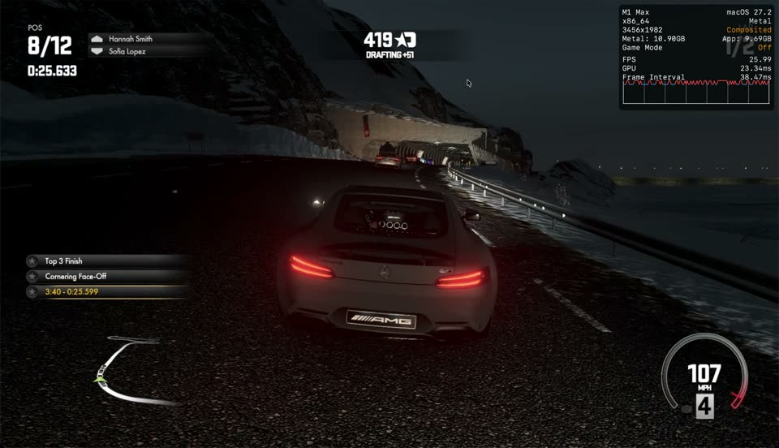

# Driveclub on Apple Silicon (Rosetta 2)

*Italiano: [APPLE_SILICON.it.md](APPLE_SILICON.it.md)*

This repository is a fork of [BlackLineInteractive/Driveclub-Port](https://github.com/BlackLineInteractive/Driveclub-Port).
Upstream's macOS backend (`src/`) targets **Intel Macs**: the PS4 game code is
x86-64 and runs natively there. This fork makes the same backend run on
**Apple Silicon** by running the whole x86-64 process under **Rosetta 2**, and
then fixes the GPU bugs and performance problems that showed up along the way.

*Not affiliated with or endorsed by Sony Interactive Entertainment. "Driveclub" and
"PlayStation" are trademarks of their owners. This repository and its releases
contain no game code or data and no keys: you need your own legitimate copy of the game.*

Everything here was developed and measured on **one machine: MacBook Pro M1 Max,
macOS 27.2, game v1.28 (CUSA00003)**. Other Apple Silicon chips have not been tested.

[](https://github.com/fladnaG86/Driveclub-Port-AppleSilicon/releases/download/apple-silicon-video/driveclub-apple-silicon.mp4)

*Gameplay on a MacBook Pro M1 Max under Rosetta 2, with the game's audio — click to play the video (MP4, 3:57). The Metal Performance HUD (top right) shows the real frame rate and the GPU time per frame.*

## Status

| Area | State |
| --- | --- |
| Boot, menus, attract screen | Works |
| Starting an event, racing a full lap | Works (online and offline, `DC_OFFLINE=1`) |
| Audio | Works |
| Input | DualShock/DualSense via SDL3 gamepad, or keyboard (see below) |
| Graphics | Race scenes render correctly as far as checked against PS4 footage; see *Known gaps* |
| Performance | ~26-28 fps in a race at 1920x1080 (M1 Max); was ~12 fps at the start of this work |
| Stability | Races of several minutes without crashes; a GPU watchdog exits cleanly if a shader hangs |

## How to play

### Start the game, step by step

1. **Check the requirements.** A Mac with Apple Silicon, **macOS 15 or later**, and **your own copy of
   Driveclub v1.28 (CUSA00003)**, decrypted and extracted to a folder. That
   folder contains `eboot.bin` and `sce_module/`. If you have the base game and
   the 1.28 patch as two folders, copy the patch's files over the base game
   folder first (replacing `eboot.bin`). Other game versions do not start: the
   app tells you if yours is one.
2. **Install the app.** Download `Driveclub-Native-0.2.5.dmg` from
   [Releases](https://github.com/fladnaG86/Driveclub-Port-AppleSilicon/releases/latest),
   open it and drag **Driveclub** onto **Applications**.
3. **First launch only: allow the app.** It is not notarized by Apple, so macOS
   blocks it the first time:
   1. Double-click **Driveclub** in Applications. macOS says it could not verify
      the app: click **Done** (not *Move to Trash*).
   2. Open **System Settings → Privacy & Security**, scroll down to
      *"Driveclub" was blocked…* and click **Open Anyway**.
   3. Enter your password and click **Open Anyway** again.

   If macOS asks to install **Rosetta**, accept. After this, a double-click is enough.
4. **Choose the game folder.** The first time, the app asks for it: pick the
   folder with `eboot.bin` and click **Play**. It is remembered; hold **Option**
   while opening the app to choose another one.
5. **Wait about 40 seconds** for loading. The window title shows the frame rate.
6. **In the game:** at the *Start Event* screen press **Cross** (`Enter`). At the
   *Controls* screen press **Cross** again. The race starts.
7. **To quit**, press `Cmd+Q`.

Every session writes its own log to the **Driveclub Logs** folder on your Desktop,
named by date and time (`driveclub-2026-10-19_17-30-45.txt`); the last 20 are kept.
A session that crashed gets `-crash` added to its name (you see it the next time you
open the app), one that ended with an error message gets `-error`. Each log starts
with your Mac model, chip and macOS version, and logs the frame rate every 10 seconds.
Attach the log of the session that went wrong to an
[issue](https://github.com/fladnaG86/Driveclub-Port-AppleSilicon/issues). The first
time, macOS asks to let Driveclub access your Desktop; if you refuse, the logs go to
`~/Library/Logs/DriveclubNative`.

**From Terminal** (debug variables, `DC_OFFLINE=1` and so on): the binary inside the
app takes the game folder as before and then logs to the terminal:
`/Applications/Driveclub.app/Contents/MacOS/driveclub /path/to/your/extracted/game`.

Saves are stored in `~/Library/Application Support/DriveclubNative`.
The game's online services are gone; if a menu waits for the network, start
with `DC_OFFLINE=1 ./driveclub /path/to/game`.

### Controls

A PS4 controller (DualShock 4 or DualSense, USB or Bluetooth) works like on the
console and can be connected at any time. The keyboard can replace it:

| PS4 button | Keyboard | In the game |
| --- | --- | --- |
| R2 | `W` | Accelerate (keyboard: full throttle) |
| L2 | `S` | Brake / reverse |
| Left stick left/right | `A` / `D` | Steer (keyboard: full lock) |
| Cross ✕ | `Enter`, `Space` or `K` | Confirm in menus |
| Circle ○ | `L` | Back in menus |
| Square □ | `J` | Game action (see the in-game *Controls* screen) |
| Triangle △ | `I` | Game action (see the in-game *Controls* screen) |
| L1 / R1 | `Q` / `E` | Game action (see the in-game *Controls* screen) |
| D-pad | Arrow keys | Move in menus |
| Options | `Esc` or `Tab` | Pause menu |
| Right stick, L3, R3, touchpad | controller only | As on PS4 |

Keys of the port itself:

| Key | Function |
| --- | --- |
| `V` | Vsync on/off |
| `F12` | Debug: record a trace of the next frame into `../bench/f12_<frame>` |
| `F11` | Debug: Xcode GPU capture of two frames (needs `MTL_CAPTURE_ENABLED=1`; very large) |

## Build and run

You can skip this section if you use the prebuilt app (see *How to play*). To build it yourself:

Requirements: Apple Silicon Mac with Rosetta 2, Xcode (command line tools),
CMake >= 3.24, Ninja, and **an x86_64 build of SDL3** (Homebrew's SDL3 on Apple
Silicon is arm64 and cannot be linked into an x86_64 binary).

```bash
# SDL3 for x86_64 (tested with release-3.2.24)
git clone --branch release-3.2.24 https://github.com/libsdl-org/SDL SDL3-src
cmake -S SDL3-src -B SDL3-build -G Ninja -DCMAKE_OSX_ARCHITECTURES=x86_64 \
      -DCMAKE_BUILD_TYPE=Release -DCMAKE_INSTALL_PREFIX=$PWD/sdl3-x86_64
cmake --build SDL3-build && cmake --install SDL3-build

# The port (CMakeLists.txt already forces x86_64 and -march=btver2)
cmake -S Driveclub-Port -B Driveclub-Port/build -G Ninja \
      -DSDL3_DIR=$PWD/sdl3-x86_64/lib/cmake/SDL3
cmake --build Driveclub-Port/build

# Run from the repository root, pointing at your own extracted game
cd Driveclub-Port && ./build/driveclub /path/to/your/extracted/CUSA00003/Image0
```

You need **your own copy of the game** as a decrypted, extracted package
(this fork was tested with v1.28). No game files are included in this repository.

To package the build as `Driveclub.app` in a `.dmg` (ad-hoc signed), pass an
x86_64 SDL3 built with `-ffile-prefix-map` so it carries no local paths:
`tools/app/make_app.sh 0.2.5 /path/to/libSDL3.0.dylib` → `dist/`.

## What was done

The commits are small and have descriptive messages; this is the map.

### 1. Running under Rosetta 2

| Problem | Fix | Commit |
| --- | --- | --- |
| `-march=native` on an arm64 host produces nothing Rosetta can run | Target `btver2` (the PS4's Jaguar CPU) | 587a6e5 |
| Rosetta reserves x86 VA `0xFC0000000-0x7000000000`: mapping guest memory there gets the process killed | Guest user range starts at `0x7000000000`; the game's hard-coded heap at `0x1000000000` is relocated by rewriting the `movabs` sites in the eboot (`DC_HEAP_SITES` overrides) | 40e4166 |
| Module start crashed: libc jumped into data | Pass no proc param to `module_start` (PRX init tail-calls it) | 2b899c7 |

### 2. GPU correctness

| Symptom | Root cause | Commit |
| --- | --- | --- |
| Grid of bokeh/flare garbage | Compute shaders written for one 64-wide GCN wave skip `s_barrier` around LDS exchanges; Metal runs them as two 32-wide SIMD groups. Barriers are inserted where LDS access changes kind | f35ac47 |
| A compute shader spun for seconds, GPU hang, Mac needed a reboot | CE/DE counter difference compared as unsigned (underflow) blocked the constant engine; stale descriptor tables fed a light loop a huge count | 4d8cd93 |
| Shaders that never finish could freeze the Mac | GPU watchdog (`DC_GPU_WATCHDOG`), loop guard in translated loops, indirect-size clamps | e419ed7 |
| Cockpit glass/windshield missing | Dual-source blending | cbfc6e7 |
| Coloured cockpit flood, huge orbs around other cars | Car liveries are BC3 textures *encoded on the GPU* into a uint render target; they were sampled raw. Now copied into a real BC texture | a4f4a1f |
| Doubled cockpit / ghost image with headlights | Light volumes use LINEAR (no perspective) barycentrics; inputs now use `center_no_perspective` | e357073 |
| Cockpit vanished for single frames at race start | Pixel-shader pipeline key hashed unused state, ~1000 needless compiles; draws were skipped while compiling | b653264 |

### 3. HLE and input

| Symptom | Root cause | Commit |
| --- | --- | --- |
| "Start Event" ignored the Cross button | `scePadRead` answered for any handle; a Logitech wheel probe (handle -1) created a phantom wheel that became player 0 | 3ef7c52 |
| No real controls | SDL3 gamepad hot-plug, analog sticks/triggers, keyboard driving | 6be57f8 |
| Misc | NP state callback, offline mode, realistic `sceSystemServiceParamGetInt` defaults, pad timestamps | 28ef31f, ec6b002, a92baaf |

### 4. Performance: ~12 fps to ~27 fps

Measured in a race, 1920x1080, M1 Max. Each step was A/B tested
(`tools/bench_race.sh`); see the commit messages for the numbers.

| Change | Effect | Commit |
| --- | --- | --- |
| Patched dispatch sizes read by the GPU (indirect dispatch) instead of 18 CPU waits per frame | 12.4 -> 14.7 fps | 4f29dd9 |
| Texture lookup cache per descriptor | draw CPU 42 -> 21 ms/frame | 480d81e |
| `WaitRegMem` also checks fences already recorded by other queues | 15.0 -> 19.1 fps | 134630d |
| Relaxed shader math | GPU 51.3 -> 48.5 ms/frame | c339b9f |
| One event signal per command buffer, batched dispatches | GPU 49.0 -> 40.2 ms/frame | de0ff50 |
| Vertex attributes fetched by a Metal vertex descriptor | vertex stage 21 -> 12 ms/frame | 2b56ba0 |
| Per-draw CPU overhead cuts (binding cache, fewer allocations, shader check once per frame) | CP thread ~25 -> ~21 ms/frame | 0c3b904, 37d021e, 6b38290 |
| **Host-translated memory bases** (see below) | GPU 35.2 -> 27.2 ms/frame | d08a95f |
| Resolve results reused per program and descriptors; memory bases translated once per draw | CP thread 22.7 -> 21.1 ms/frame, ~+1-2 fps | 4d6df28 |

**Host-translated bases (d08a95f).** Shaders reach guest memory through a page
table. The Xcode capture of the heaviest shader (the TAA, 4.3 ms) showed 196
allocated registers and near-zero occupancy. Disassembling its AGX machine code
(`tools/agx`) showed ~10,000 integer instructions spent on address translation
against ~70 floating-point ones. Now the program analysis finds memory bases
whose registers hold the same value on every path. The renderer translates
those *addresses* on the CPU per draw. Data is still read by the GPU, so values
the GPU writes later in the frame stay correct. The pipeline is then specialized
so those accesses index the memory buffer directly. TAA: 98 -> 80 registers,
12.8k -> 3.6k instructions, 4.3 -> 2.1 ms.

## What is left

**Performance is now CPU-bound.** In a race the GPU is busy ~68% of the time
(~27 ms/frame of work); the frame takes ~40 ms. The limits are:

1. **The command processor thread** (`GPU gfx`): ~22 ms of CPU per frame for
   ~2,200 draws (~10 µs each under Rosetta). Biggest parts: `Resolve`
   (texture descriptors, `GetTexture`/`TextureChanged` hashing ~550 textures
   per frame), render-encoder creation (~100 passes, ~50 µs each), mutex
   contention with the 32 compute-queue threads, and `LinearTable` (~1.7 ms).
2. **The game's own threads under Rosetta.** Instruments showed the GPU idle in
   2-3 gaps per frame while the game's TBB workers compute; the main thread
   spin-waits on the end-of-frame label.
3. Remaining expensive GPU work: `cs 0x7000102e00` (interior light probe,
   ~4-5 ms), `ps 0x7068ce9900` (960x540, ~2.8 ms), `cs 0x7002fdf100` (~2 ms).
   `DC_PASS_TIMING` lists them.

**Known gaps:**

- Texture format `dfmt=49 nfmt=4` (R4G4) is not supported.
- Shader op `IMAGE_ATOMIC_ADD` is not translated.
- Unimplemented HLE functions still called, without visible effect so far:
  VideoOut `DYhhWbJSeRg`/`pv9CI5VC+R0`, GnmDriver `0H2vBYbTLHI`, several NP /
  WebApi / Rudp / SharePlay functions (online features), libkernel
  `FxVZqBAA7ks`/`ca7v6Cxulzs`/`4oXYe9Xmk0Q`. 227 imports are still unresolved.
- Only tested on M1 Max. Only race scenes were checked against PS4 footage.
- Frame dumps are not reproducible across runs (timing differs), so judge
  changes by counters, not by comparing images.

**Tried and measured with no gain** (so you don't have to):
structured control flow in the generated MSL instead of the flat `tgt_` chain
(registers unchanged); dropping the upper halves of lane masks; broadcasting
scalar loads with `simd_broadcast_first` (AGX uniform registers are only filled
by the per-dispatch preamble); resolving scalar loads' *values* on the CPU (only
safe for descriptors, which gave nothing); merging render passes (only ~10 of
~100 are needless splits); page-protection write tracking for textures
(reverted: GPU writes don't fault, so textures would go stale); a multi-range
address translator (slower); early commits when the GPU idles.

## Debugging and profiling tools

All tools are environment variables unless stated. They are cheap when off.

| Tool | What it does |
| --- | --- |
| `tools/bench_race.sh <label> [VAR=..]` | Starts an event, holds the throttle 150 s, prints fps, GPU busy, errors, GPU ms/frame, CP CPU ms/frame |
| `DC_GPU_STATS=1` | Per-second fps, GPU busy %, passes and why they were split, CP thread CPU |
| `DC_PASS_TIMING=1` | GPU time per render pass and dispatch, from stage-boundary timestamps (no extra splits) |
| `DC_CPU_PROFILE=1` | CPU time per section of a draw |
| `F12` / `DC_TRACE_FRAME=n` | Traces one frame: every draw/dispatch with its resources; `DC_DUMP_PASSES=1` dumps each pass's targets |
| `F11` / `DC_CAPTURE_AT=n` | Xcode GPU capture of two frames (large: ~70 GB). Needs `MTL_CAPTURE_ENABLED=1` and `DC_GPU_WATCHDOG=120` |
| `DC_CAPTURE_CS=<addr>[:flip]` | Xcode capture of a single dispatch (~6.5 GB): open it, Replay, Profile to see registers and limiters |
| `DC_SKIP_CS=<addr>` / `DC_SKIP_PS=<addr>` | Drop one shader's work to A/B its cost |
| `DC_MSL_OVERRIDE=<dir>` | Load `<dir>/<stage>_<hash>.metal` instead of the generated MSL (hand-edited experiments) |
| `DC_DUMP_SHADERS=<dir>` | Dump guest shader binaries and generated MSL |
| `DC_SCAN_MAX=...`, `DC_PROBE=...` | Find blown-up values per pass/draw; read registers of one pixel/thread |
| `DC_NO_LINEAR`, `DC_NO_TEX_CACHE`, `DC_NO_SIGNAL_BATCH`, `DC_SW_FETCH`, `DC_MATH_MODE=safe` | Turn individual optimizations off |
| `DC_TRACE_HLE=<sec>`, `DC_LOG_UNRESOLVED_ALL`, `DC_LOG_MISSING`, `DC_PROBE_FN=...` | HLE call traces and guest function probes |
| `build/gcn_dis <bin> [vs/ps/cs] [--msl] [key=value]` | Disassemble a guest shader, generate and compile its MSL, print max threads, linear bases |
| `tools/agx/agxstat.sh <file.metal>` | AGX register count and instruction count of a kernel (needs `dougallj/applegpu` cloned into `tools/agx/applegpu`) |
| `tools/msl_check.py` | Regression checks on the MSL generated for small fixtures |

Practical notes:

- If a run hangs the GPU, the killed process can stay in state `E` holding the GPU;
  only a reboot clears it. Check `ps -axo stat,command | grep driveclub` before benchmarking.
- `lldb` loses the process under Rosetta; `sample <pid>` works (symbolize with `nm`).
- `xctrace`/Instruments needs an Xcode version that matches the OS.
